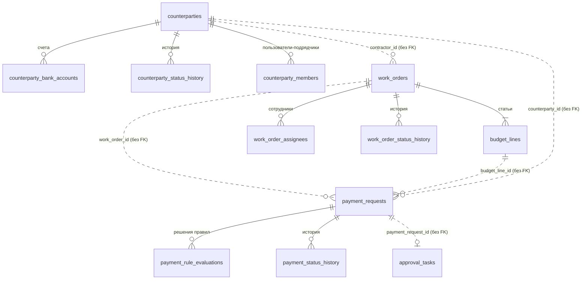

# billing-service: схема базы данных

База `billing_db` (PostgreSQL). Декомпозиция по модулям: [BILLING_DECOMPOSITION.md](BILLING_DECOMPOSITION.md).
Миграции Liquibase лежат в `billing-service/src/main/resources/db/changelog/<модуль>/`, по одной папке на модуль.

| Модуль | Таблицы | Миграция |
|---|---|---|
| counterparties | `counterparties`, `counterparty_bank_accounts`, `counterparty_status_history`, `counterparty_members` | ✅ этап 1 |
| workorders | `work_orders`, `budget_lines`, `work_order_assignees`, `work_order_status_history` | этап 2 |
| payments | `payment_requests`, `payment_rule_evaluations`, `payment_status_history` | этап 3 |
| rules | нет: чистая логика без хранения | — |
| approvals | `approval_tasks` | этап 4 |
| reporting | таблицы для чтения (read model) | этап 7 |
| (Spring Modulith) | `event_publication`: журнал событий для outbox | этап 4, создаётся автоматически |

---

## Соглашения

| Что | Как | Почему |
|---|---|---|
| Первичные ключи | `UUID`, генерирует приложение | как в auth-service; id не выдаёт количество записей и не конфликтует при переносе данных |
| Деньги | `NUMERIC(19,2)` ↔ `BigDecimal` | `double` теряет копейки: `0.1 + 0.2 ≠ 0.3` |
| Валюта | `CHAR(3)`, по умолчанию `'RUB'` | ISO 4217; пока везде рубли, но поле дешевле добавить сразу |
| Время | `TIMESTAMP` в UTC ↔ `Instant` | как в auth-service |
| Статусы и типы | `VARCHAR` + `CHECK` со списком значений ↔ `@Enumerated(EnumType.STRING)` | читается в БД, а новое значение добавляется миграцией без пересоздания типа |
| Кто изменил | `created_by` / `changed_by` типа `UUID` | id пользователя из `X-User-Id`; FK на пользователей нет, они в другой базе |
| Конкурентные изменения | `version BIGINT` ↔ `@Version` (оптимистическая блокировка) | два одновременных платежа не должны оба уложиться в один и тот же остаток статьи |
| Аудит статусов | отдельная таблица `*_status_history` | для финансов важно, **кто, когда и почему** сменил статус |

### Внешние ключи между модулями: не ставим
Внутри модуля FK есть, например `counterparty_bank_accounts → counterparties`. **Между модулями** храним только id
(`work_orders.contractor_id` указывает на контрагента, но без FK).

- **Плюс:** модули не сцеплены на уровне базы. Модуль можно вынести в отдельный сервис со своей БД, и ничего не сломается.
  Это тот же принцип, по которому у каждого микросервиса своя база.
- **Минус:** целостность между модулями проверяет код (через публичный API модуля), а не база.

### Снимки данных (snapshot)
Платёж хранит **копию** реквизитов получателя на момент создания (`recipient_inn`, `recipient_account`, …),
а не только ссылку на контрагента. Если контрагент потом сменит счёт, история платежей не должна измениться.
Для финансовых документов это обязательное правило.

---

## Модуль `counterparties` (этап 1)

### `counterparties`: контрагенты
| Колонка | Тип | Ограничения | Описание |
|---|---|---|---|
| `id` | `UUID` | PK | |
| `type` | `VARCHAR(30)` | NOT NULL, CHECK (`LEGAL_ENTITY`, `INDIVIDUAL_ENTREPRENEUR`, `SELF_EMPLOYED`) | юрлицо, ИП, самозанятый. Физлиц нет **намеренно** |
| `name` | `VARCHAR(255)` | NOT NULL | полное наименование: «ООО "СтройМатериалы"», «ИП Иванов Иван Иванович» |
| `short_name` | `VARCHAR(255)` | | краткое наименование для списков |
| `inn` | `VARCHAR(12)` | NOT NULL, CHECK только цифры, длина 10 или 12 | ИНН: 10 цифр у юрлица, 12 у ИП и самозанятого |
| `kpp` | `VARCHAR(9)` | CHECK 9 символов | КПП: только у юрлица |
| `ogrn` | `VARCHAR(15)` | CHECK только цифры, длина 13 или 15 | ОГРН юрлица (13) или ОГРНИП (15); у самозанятых нет |
| `legal_address` | `VARCHAR(500)` | | юридический адрес |
| `contact_email` | `VARCHAR(100)` | | |
| `contact_phone` | `VARCHAR(20)` | | |
| `verification_status` | `VARCHAR(20)` | NOT NULL, DEFAULT `'NEW'`, CHECK (`NEW`, `VERIFIED`, `SUSPICIOUS`, `BLOCKED`) | статус проверки |
| `created_at` | `TIMESTAMP` | NOT NULL | |
| `created_by` | `UUID` | NOT NULL | кто завёл |
| `updated_at` | `TIMESTAMP` | NOT NULL | |
| `version` | `BIGINT` | NOT NULL, DEFAULT 0 | оптимистическая блокировка |

**Уникальность:** `UNIQUE (inn, COALESCE(kpp, ''))`. У филиалов юрлица ИНН один, а КПП разные, поэтому уникальна
пара «ИНН + КПП». `COALESCE` нужен потому, что в PostgreSQL два `NULL` в уникальном индексе считаются разными,
и без него у ИП можно было бы завести дубль.

**Индексы:** по `verification_status` (фильтр списка), по `lower(name)` (поиск по названию).

Контрольную сумму ИНН проверяет приложение: в базе это неудобно, а в коде легко покрыть тестами.

### `counterparty_bank_accounts`: банковские счета контрагента
| Колонка | Тип | Ограничения | Описание |
|---|---|---|---|
| `id` | `UUID` | PK | |
| `counterparty_id` | `UUID` | NOT NULL, FK → `counterparties`, ON DELETE CASCADE | |
| `account_number` | `VARCHAR(20)` | NOT NULL, CHECK 20 цифр | расчётный счёт |
| `bik` | `VARCHAR(9)` | NOT NULL, CHECK 9 цифр | БИК банка |
| `bank_name` | `VARCHAR(255)` | NOT NULL | |
| `correspondent_account` | `VARCHAR(20)` | CHECK 20 цифр | корр. счёт банка |
| `is_primary` | `BOOLEAN` | NOT NULL, DEFAULT false | основной счёт для платежей |
| `active` | `BOOLEAN` | NOT NULL, DEFAULT true | закрытые счета не удаляем, а деактивируем |
| `created_at` | `TIMESTAMP` | NOT NULL | |

**Уникальность:** `UNIQUE (counterparty_id, bik, account_number)`. **Один основной счёт:** частичный уникальный индекс
`UNIQUE (counterparty_id) WHERE is_primary AND active`.

### `counterparty_status_history`: история смены статуса
| Колонка | Тип | Ограничения | Описание |
|---|---|---|---|
| `id` | `UUID` | PK | |
| `counterparty_id` | `UUID` | NOT NULL, FK → `counterparties`, ON DELETE CASCADE | |
| `old_status` | `VARCHAR(20)` | | `NULL` при создании |
| `new_status` | `VARCHAR(20)` | NOT NULL | |
| `reason` | `VARCHAR(1000)` | | причина: обязательна для `BLOCKED` и `SUSPICIOUS` (проверяет приложение) |
| `source` | `VARCHAR(20)` | NOT NULL, CHECK (`MANUAL`, `FNS_CHECK`) | вручную или автоматическая проверка ФНС (этап 6) |
| `changed_by` | `UUID` | | `NULL`, если изменила система |
| `changed_at` | `TIMESTAMP` | NOT NULL | |

Индекс по `(counterparty_id, changed_at)`.

### `counterparty_members`: пользователи-подрядчики
Связывает пользователя из auth-service с компанией-контрагентом, от имени которой он работает. Без этого нельзя
сказать «подрядчик видит только свои распоряжения»: распоряжение выдано **компании-подрядчику**, а в систему
входит **человек**.

| Колонка | Тип | Ограничения | Описание |
|---|---|---|---|
| `counterparty_id` | `UUID` | NOT NULL, FK → `counterparties`, ON DELETE CASCADE | |
| `user_id` | `UUID` | NOT NULL, **UNIQUE** | id пользователя auth-service с ролью `ROLE_CONTRACTOR`; один пользователь — одна компания |
| `added_by` | `UUID` | NOT NULL | |
| `added_at` | `TIMESTAMP` | NOT NULL | |

PK `(counterparty_id, user_id)`.

---

## Модуль `workorders` (этап 2)

### `work_orders`: распоряжения
| Колонка | Тип | Ограничения | Описание |
|---|---|---|---|
| `id` | `UUID` | PK | |
| `number` | `VARCHAR(30)` | NOT NULL, UNIQUE | человекочитаемый номер, например `WO-2026-000123` |
| `title` | `VARCHAR(255)` | NOT NULL | «Ремонт помещения 3.14» |
| `description` | `TEXT` | | |
| `work_object` | `VARCHAR(500)` | NOT NULL | объект работ: здание, помещение, сектор |
| `contractor_id` | `UUID` | NOT NULL | контрагент-подрядчик (без FK: другой модуль) |
| `manager_id` | `UUID` | NOT NULL | ответственный менеджер |
| `status` | `VARCHAR(20)` | NOT NULL, CHECK (`DRAFT`, `APPROVED`, `IN_PROGRESS`, `COMPLETED`, `CANCELLED`) | |
| `total_budget` | `NUMERIC(19,2)` | NOT NULL, CHECK > 0 | общий бюджет |
| `currency` | `CHAR(3)` | NOT NULL, DEFAULT `'RUB'` | |
| `start_date` / `end_date` | `DATE` | CHECK `end_date >= start_date` | сроки работ |
| `approved_by` / `approved_at` | `UUID` / `TIMESTAMP` | | кто и когда утвердил |
| `created_at`, `created_by`, `updated_at`, `version` | | | как везде |

Индексы: `contractor_id`, `status`, `manager_id`.

### `budget_lines`: статьи сметы
| Колонка | Тип | Ограничения | Описание |
|---|---|---|---|
| `id` | `UUID` | PK | |
| `work_order_id` | `UUID` | NOT NULL, FK → `work_orders`, ON DELETE CASCADE | |
| `category` | `VARCHAR(30)` | NOT NULL, CHECK (`MATERIALS`, `EQUIPMENT`, `LABOR`, `TRANSPORT`, `OTHER`) | |
| `limit_amount` | `NUMERIC(19,2)` | NOT NULL, CHECK >= 0 | лимит статьи |
| `reserved_amount` | `NUMERIC(19,2)` | NOT NULL, DEFAULT 0, CHECK >= 0 | одобрено, но банк ещё не провёл |
| `spent_amount` | `NUMERIC(19,2)` | NOT NULL, DEFAULT 0, CHECK >= 0 | проведено банком |
| `version` | `BIGINT` | NOT NULL, DEFAULT 0 | **критично:** защищает остаток от параллельных платежей |

- `UNIQUE (work_order_id, category)`: одна статья каждой категории в распоряжении.
- `CHECK (reserved_amount + spent_amount <= limit_amount)`: последняя линия обороны. Даже при ошибке в коде
  база не даст потратить больше лимита.
- Остаток = `limit_amount − reserved_amount − spent_amount`. Его не храним, а вычисляем.
- Правило «сумма лимитов статей = `total_budget`» проверяет приложение.

### `work_order_assignees`: сотрудники на распоряжении
`work_order_id` (FK, CASCADE) + `user_id`, PK из обоих; плюс `assigned_at`. Нужна, чтобы `ROLE_EMPLOYEE` видел
только назначенные ему распоряжения.

### `work_order_status_history`
Как `counterparty_status_history`: `work_order_id`, `old_status`, `new_status`, `comment`, `changed_by`, `changed_at`.

---

## Модуль `payments` (этап 3)

### `payment_requests`: заявки на оплату
| Колонка | Тип | Ограничения | Описание |
|---|---|---|---|
| `id` | `UUID` | PK | |
| `number` | `VARCHAR(30)` | NOT NULL, UNIQUE | `PR-2026-000456` |
| `work_order_id` | `UUID` | NOT NULL | распоряжение (без FK) |
| `budget_line_id` | `UUID` | NOT NULL | статья сметы (без FK) |
| `counterparty_id` | `UUID` | NOT NULL | получатель (без FK) |
| `recipient_name`, `recipient_inn`, `recipient_kpp` | `VARCHAR` | NOT NULL (кроме КПП) | **снимок** реквизитов |
| `recipient_account`, `recipient_bik`, `recipient_bank_name` | `VARCHAR` | NOT NULL | **снимок** банковского счёта |
| `amount` | `NUMERIC(19,2)` | NOT NULL, CHECK > 0 | |
| `currency` | `CHAR(3)` | NOT NULL, DEFAULT `'RUB'` | |
| `purpose` | `VARCHAR(210)` | NOT NULL | назначение платежа (210 символов — лимит поля платёжного поручения) |
| `basis_document` | `VARCHAR(255)` | | основание: номер счёта или акта |
| `status` | `VARCHAR(30)` | NOT NULL, CHECK (`CREATED`, `CHECKING`, `PENDING_APPROVAL`, `APPROVED`, `REJECTED`, `BLOCKED`, `SENT_TO_BANK`, `COMPLETED`, `FAILED`) | машина состояний |
| `idempotency_key` | `VARCHAR(100)` | NOT NULL | ключ от клиента: повторное нажатие «Оплатить» не создаст второй платёж |
| `bank_transaction_id` | `VARCHAR(100)` | UNIQUE | id операции в abs-service |
| `failure_reason` | `VARCHAR(1000)` | | |
| `created_at`, `created_by`, `updated_at`, `version` | | | |

- `UNIQUE (created_by, idempotency_key)`.
- Индексы: `(work_order_id, created_at)`, `status`, `budget_line_id`.

### `payment_rule_evaluations`: решения движка правил
У модуля `rules` своей БД нет. Результат проверки сохраняет `payments`: это объяснение для подрядчика и аудит.

| Колонка | Тип | Ограничения | Описание |
|---|---|---|---|
| `id` | `UUID` | PK | |
| `payment_request_id` | `UUID` | NOT NULL, FK → `payment_requests`, ON DELETE CASCADE | |
| `decision` | `VARCHAR(20)` | NOT NULL, CHECK (`ALLOW`, `BLOCK`, `REQUIRE_APPROVAL`) | итог |
| `results` | `JSONB` | NOT NULL | список правил: `[{"rule":"BUDGET_LINE_REMAINDER","outcome":"FAILED","message":"Доступно 100 000 ₽"}]` |
| `evaluated_at` | `TIMESTAMP` | NOT NULL | |

`JSONB`, а не отдельная таблица на каждое правило, потому что результаты всегда читаются и пишутся целиком,
а набор правил будет меняться. В Hibernate это поле маппится через `@JdbcTypeCode(SqlTypes.JSON)`.

### `payment_status_history`
`payment_request_id` (FK, CASCADE), `old_status`, `new_status`, `comment`, `changed_by` (`NULL` = система),
`changed_at`.

---

## Модуль `approvals` (этап 4)

### `approval_tasks`: задачи на согласование
| Колонка | Тип | Ограничения | Описание |
|---|---|---|---|
| `id` | `UUID` | PK | |
| `payment_request_id` | `UUID` | NOT NULL, **UNIQUE** | одна задача на платёж (без FK: другой модуль). UNIQUE заодно защищает от повторного события |
| `payment_number` | `VARCHAR(30)` | NOT NULL | снимок для списка задач |
| `amount` | `NUMERIC(19,2)` | NOT NULL | снимок |
| `reason` | `VARCHAR(1000)` | NOT NULL | почему нужно согласование (из правил) |
| `status` | `VARCHAR(20)` | NOT NULL, CHECK (`PENDING`, `APPROVED`, `REJECTED`) | |
| `requested_at` | `TIMESTAMP` | NOT NULL | |
| `decided_by` / `decided_at` | `UUID` / `TIMESTAMP` | | финансовый директор и время решения |
| `decision_comment` | `VARCHAR(1000)` | | обязателен при отклонении |
| `version` | `BIGINT` | NOT NULL, DEFAULT 0 | два директора не могут одновременно принять разные решения |

Индекс `(status, requested_at)` для очереди «ожидают решения».

---

## Модуль `reporting` (этап 7, черновик)
Таблицы для чтения, которые обновляются по событиям из других модулей:
- `report_work_order_budget`: распоряжение, подрядчик, бюджет, зарезервировано, потрачено, число заблокированных платежей;
- `report_payment_journal`: плоский журнал платежей со статусом и причиной блокировки.

Точная структура определится на этапе 7 вместе с набором событий.

---

## Связи

Сплошная линия — FK внутри модуля, пунктир — ссылка по id между модулями.
