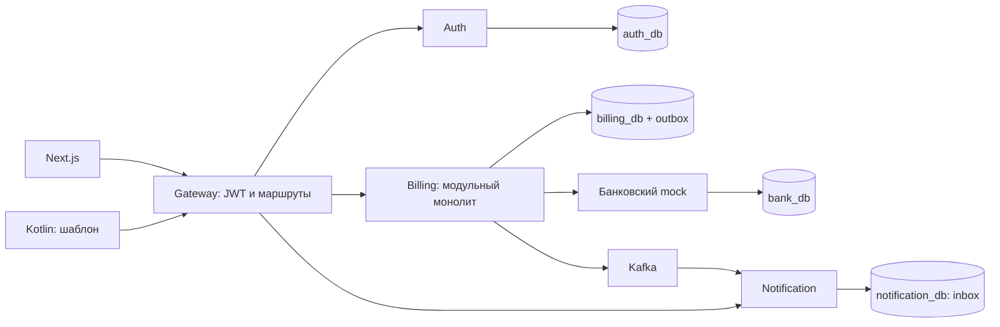

# ADR-0002: границы транзакций демонстрационного MVP

Дата: 2026-11-28. Статус: принято для локального single-tenant MVP.

## Контекст

Нужно демонстрировать сохранение бюджетных ограничений и безопасный повтор операции при сетевом сбое. Деление каждого модуля billing на отдельный процесс потребовало бы распределённого согласования бюджета, которое не помогает проверять эту гипотезу на данном этапе.

## Решение

`counterparties` владеет контрагентами и реквизитами; наружу предоставляет `CounterpartyDirectory`. `workorders` владеет распоряжениями и статьями, предоставляет `BudgetLedger`. `payments` координирует заявку, согласование, отправку в банк, историю и outbox. `rules` возвращает решение и причину. `reporting` обращается к публичным сервисам этих модулей.

В MVP согласования хранятся в `approval_tasks` и изменяются в той же транзакции, что платёж. Отдельный пакет approvals из плана не означает отдельной реализации. Reporting строит актуальную сводку чтением billing_db; асинхронной проекции пока нет. Проверка Spring Modulith запрещает циклы и обращения к внутренним Java-типам; она не анализирует владельцев таблиц внутри SQL.

Контрагенты используют JPA, новые финансовые операции — JdbcTemplate. Это осознанный выбор для явных условных UPDATE, SELECT FOR UPDATE и транзакционных advisory locks. Оба механизма работают с одним DataSource и транзакциями Spring; наружу не передаются JPA entities. Ответы новых API пока построены на record-командах и map-проекциях; выделение стабильных типизированных response DTO — следующий шаг перед внешними потребителями.

## Бюджет

Для каждой статьи: `available = limit - reserved - spent`, `reserved >= 0`, `spent >= 0`, `reserved + spent <= limit`. Денежные расчёты выполняются BigDecimal / numeric(19,2). UI только отображает суммы.

Создание заявки блокирует строку распоряжения и статьи; условный UPDATE резервирует сумму. Ограничения БД — дополнительная защита. Одновременно вставляются заявка, задача согласования при необходимости, история и событие outbox. BLOCKED не резервирует деньги. PENDING_APPROVAL резервирует, поскольку будущие заявки не должны занять уже обещанную сумму.

Идемпотентность входного запроса привязана к `(created_by, Idempotency-Key)`. Транзакционный advisory lock сериализует конкурирующие повторы, UNIQUE ограничение страхует дубли. Ключ с другим содержимым даёт 409. Разные ключи считаются разными заявками; клиент обязан сохранять ключ при повторе.

## Внешний банковский эффект

1. `prepareNext()` фиксирует PROCESSING и намерение отправить команду в отдельной транзакции.
2. `deliver()` вызывает банк с постоянным payment UUID. Успешный результат переводит резерв в потраченное; подтверждённый отказ освобождает резерв.
3. При таймауте неизвестно, успел ли банк списать деньги. Резерв сохраняется. После паузы worker повторяет ту же команду.
4. Банк хранит результат по payment UUID, проверяет одинаковость суммы/реквизитов и возвращает прежний ответ на повтор. Поэтому потеря HTTP-ответа не приводит ко второму списанию.
5. Ошибка локальной бухгалтерии откатывает транзакцию; это не сетевой таймаут. Сохранённый в банке результат можно получить повторно.

Перед первой отправкой реквизиты и статус сверяются со снимком. После начала отправки сначала выясняется исход старой команды, даже если реквизиты изменились: освобождать резерв до выяснения исхода нельзя. Сверка не является распределённой блокировкой реквизитов; их изменение после проверки не отменяет уже отправленную команду.

Worker держит блокировку платежа во время короткого HTTP-вызова. Это упрощает MVP, но ограничивает throughput. Следующий этап — lease/claim worker, backoff, лимиты и отдельный операторский сценарий сверки зависших платежей. Сейчас неизвестный результат повторяется до подтверждения, ручного списания резерва нет.

## События

Outbox находится в одной транзакции с бизнес-изменением. Один publisher на БД выбирается advisory lock; сообщения публикуются по sequence, Kafka key = payment UUID. UUID события постоянен при повторе публикации.

После подтверждения Kafka publisher отмечает published_at. Сбой между отправкой и отметкой даёт дубликат — это нормальный at-least-once сценарий. Consumer сохраняет событие транзакционно с UNIQUE(eventId) и `ON CONFLICT DO NOTHING`. Offset подтверждается после обработки. Повреждённое событие повторяется и попадает в DLT. Это не глобальная exactly-once транзакция PostgreSQL + Kafka + HTTP.

## Безопасность и границы

Gateway проверяет JWT и заменяет входящие заголовки идентичности. Billing дополнительно проверяет роли и доступ к распоряжению. Внутренние порты сервисов не опубликованы. Общая Docker-сеть является доверенной границей MVP, а не заменой mTLS в production.

Роль финансового директора разрешает согласование; запрет согласовывать собственные заявки отдельному пользователю с несколькими ролями пока не реализован. Не заявляем строгий принцип «четырёх глаз». Новые demo-аккаунты имеют по одной роли.

У каждого процесса собственная БД. Обычный код сервисов не читает чужие БД. Межсервисные user UUID являются ссылками без внешних ключей; существование и роль при ручной привязке нужно контролировать отдельно. Внешний integration-service и цифровой рубль в контур не входят.
